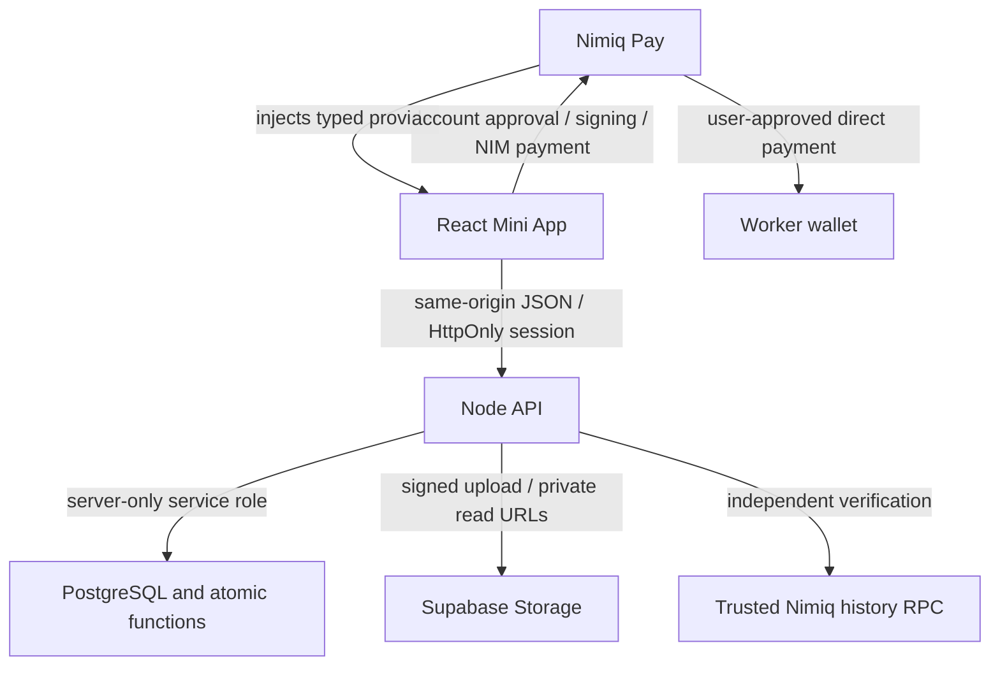
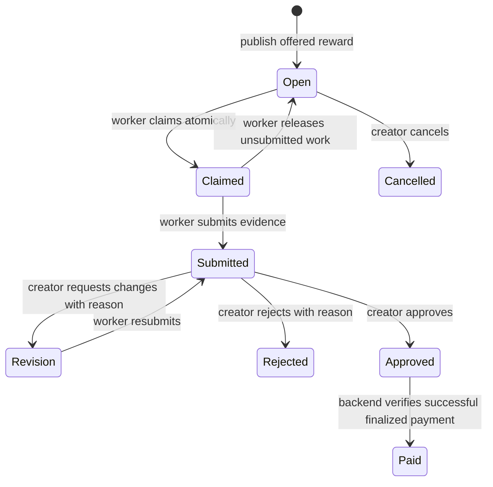

# Bountex architecture

## Stack and boundaries

| Layer         | Implementation                                          | Responsibility                                                        |
| ------------- | ------------------------------------------------------- | --------------------------------------------------------------------- |
| Mini App host | Nimiq Pay, `@nimiq/mini-app-sdk` 0.2.5                  | Wallet account approval, signing and native NIM payments              |
| Frontend      | Vite, React, TypeScript                                 | Discovery, posting, work, review, rewards and receipts                |
| UI            | Custom CSS, Lucide, self-hosted Inter and Space Grotesk | Responsive layouts and component styling                              |
| Motion        | Framer Motion; Three.js through React Three Fiber       | UI transitions and the floating reward sculpture                      |
| API           | Node.js 22, Vercel function; local HTTP server          | Authentication, authorization, validation and chain verification      |
| Database      | Supabase PostgreSQL                                     | Profiles, one-time challenges, sessions, tasks and payout intents     |
| Evidence      | Supabase private Storage bucket                         | Bounded uploads and short-lived authorized read URLs                  |
| Chain reads   | Trusted history-enabled Albatross RPC                   | Sender contract ownership, execution, transaction fields and finality |



Preview mode is a separate local-storage workspace with explicit sample labels. Preview accounts cannot authenticate to the API or publish sample tasks into the live database.

## Authentication

1. The host shares the wallet address through `listAccounts()`.
2. The API issues a five-minute challenge containing the exact app origin, normalized address, network, nonce and expiry.
3. The host signs the message only with user approval.
4. The server verifies the Nimiq signed-message prefix, SHA-256 digest, Ed25519 signature and public-key-derived wallet address using `@nimiq/core`.
5. A conditional delete consumes the challenge once. Concurrent replay attempts fail.
6. A random token creates a seven-day session. Only its SHA-256 hash is stored in PostgreSQL; the browser receives an HttpOnly, SameSite=Strict cookie, Secure on HTTPS.

Every mutation checks `Origin` against `APP_ORIGIN`. Authentication and uploads have persisted rate limits. The device identifier is not used as identity.

## Database

| Table             | Purpose                                               | Invariants                                                  |
| ----------------- | ----------------------------------------------------- | ----------------------------------------------------------- |
| `profiles`        | Wallet-owned account and display name                 | Normalized address is the account key                       |
| `challenges`      | One-time sign-in messages                             | Short expiry; atomic consumption                            |
| `sessions`        | Hashed session tokens                                 | Expiring, server-only                                       |
| `tasks`           | Requirements, reward, worker and lifecycle            | Positive integer Luna; one worker; creator cannot be worker |
| `uploads`         | File ownership and expected metadata                  | Belongs to one task and worker; 10 MB maximum               |
| `payment_intents` | Frozen payout recipient, amount, sender and reference | One intent per task; globally unique hash and reference     |
| `reports`         | Worker reports for maintainers                        | One report per worker/task, with a reason                   |
| `rate_limits`     | Shared API request windows                            | Atomic per-key counters                                     |

Direct access with anonymous or ordinary authenticated Supabase keys is denied. Only server-side service-role requests can reach these tables and functions. The API hides submitted evidence and review feedback from unrelated users.

Task mutation functions lock the task row before checking its current state. Posting locks the creator profile before applying the three-active-bounty cap. Claims lock the worker profile before applying the work cap. Payout confirmation locks the task and intent in a consistent order.

## Task lifecycle



Revisions extend the deadline to at least 48 hours from the review. Reward and requirements are immutable in this MVP. Approval does not imply payment.

## Payout lifecycle

1. Read current host accounts and verify that the first wallet address matches the authenticated creator.
2. If a second HTLC address is listed, independently query its account. Its sender/refund party or recipient must match the creator. Freeze the validated spending address in the intent. A client-provided HTLC address alone is insufficient.
3. Create or retrieve the task's unique payout intent with the immutable worker address, integer reward and a compact `BXT:` task reference under 64 UTF-8 bytes.
4. Check the host network and consensus, then atomically lock the intent before opening native payment approval. Only one request can move it from ready to uncertain.
5. Send the reward via `sendBasicTransactionWithData`. Fees are chosen by the host. A clearly typed `PERMISSION_DENIED` can release a rejected attempt. Other ambiguous outcomes remain locked.
6. Persist the returned hash locally before sending it to the API. Recording the same hash is idempotent; changing a recorded hash or reusing it for another task is rejected.
7. The API checks successful execution, hash, network, frozen sender, worker recipient, exact Luna amount, task reference, inclusion height and timestamp.
8. Read the latest header and verify its network. Ask the node's `getLastMacroBlock` policy for the checkpoint height, accounting for the network's genesis offset, and verify that height is a canonical macro block on the same network. Wait until that checkpoint is at or after inclusion, then refetch the transaction to detect a changed inclusion block. Mark both intent and task paid atomically.

Pending receipts can be rechecked manually; an open participant receipt polls every eight seconds. Task lists refresh every 20 seconds while the tab is visible. A failed network read preserves the last successful data. Unknown wallet results expose recovery using the existing hash and never automatically send a second transaction.

The RPC node is part of the trusted verification boundary. This MVP does not run a consensus client or independently verify macro-block signatures. An actual native-device payment and the host's current HTLC layout still need live acceptance testing.

## API surface

| Endpoint                                                       | Purpose                                    |
| -------------------------------------------------------------- | ------------------------------------------ |
| `GET /api/config`                                              | Public configuration readiness and network |
| `POST /api/auth/challenge`, `/verify`                          | Signed-wallet authentication               |
| `GET /api/auth/me`, `POST /api/auth/logout`                    | Session management                         |
| `GET /api/tasks`, `POST /api/tasks`                            | Discovery / own work and publishing        |
| `POST /api/tasks/:id/claim`, `/release`, `/cancel`             | Task ownership transitions                 |
| `POST /api/tasks/:id/upload`, `/evidence-url`, `/submit`       | Private evidence                           |
| `POST /api/tasks/:id/approve`, `/revise`, `/reject`, `/report` | Review and reporting                       |
| `POST /api/tasks/:id/payment-intent`, `/start-payment`         | Freeze and lock a payout                   |
| `POST /api/tasks/:id/record-payment`, `/verify-payment`        | Receipt reconciliation and confirmation    |
| `POST /api/tasks/:id/cancel-payment`                           | Explicitly rejected wallet prompt only     |

## Directory layout

```text
src/
  App.tsx                    Navigation, workspace state and actions
  styles.css                 Visual tokens, layouts and responsive rules
  components/                Hero, 3D scene, cards, dialogs, create and review
  lib/                       SDK adapter, API client, types and sample data
server/
  handler.ts                 API routing, validation and authorization
  security.ts                Wallet signature and session primitives
  payments.ts                HTLC ownership and chain verification
  database.ts                Supabase access and response mapping
  dev.ts                     Local HTTP server
api/[...path].ts             Vercel entry point
supabase/migrations/         Database schema, constraints and atomic functions
tests/                      Signature, RPC, SQL and browser acceptance tests
docs/                       Design, architecture, checklist and validation
```
